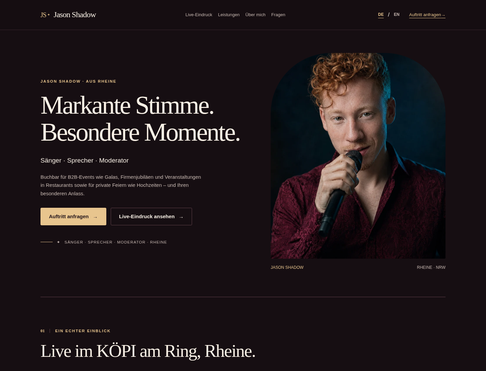

# Website-Umbau zur Prüfung

Stand: 29. Oktober 2026. Diese Fassung wurde auf dem Branch
`fix/occupation-and-event-offering` als Korrektur des bereits zusammengeführten Umbaus vorbereitet. Die Produktionsseite und die
Umgebungskonfiguration wurden nicht veröffentlicht oder umgestellt.

## Was sich geändert hat

Die Website stellt Jason Shadow als „Sänger · Sprecher · Moderator“ bzw.
„Singer · Speaker · Moderator“ aus Rheine vor. Er ist für B2B-Events wie Galas,
Firmenjubiläen und Veranstaltungen in Restaurants sowie für private Feiern wie
Hochzeiten buchbar. Die Angebote sind konkret beschrieben, ohne erfundene Erfahrung,
VIP-Referenzen, Repertoire-, Reise- oder Verfügbarkeitszusagen. Deutsch steht
unter `/`, Englisch unter `/en/`; beide Seiten enthalten die wichtigen Inhalte
bereits im HTML. Ein echter KÖPI-Mitschnitt ersetzt leere Portfolio-Plätze,
ein echtes Porträt ersetzt die Abhängigkeit von einem neuen Showreel.

Das Weinrot-/Gold-Design führt zu einer kurzen Anfrage mit Name, E-Mail,
gewünschter Leistung und Nachricht. Der bisherige FormSubmit-Empfänger bleibt
erhalten. Ein Erfolgshinweis erscheint erst nach einer bestätigten Annahme des
Dienstes; Fehler erhalten die Eingaben und bieten die öffentliche E-Mail als
Alternative an. Budgetvorgaben, unvollständige News und der funktionslose
Signature-Song-Player wurden entfernt.

Die statische Vite-/Cloudflare-Pages-Architektur bleibt erhalten. Canonicals,
gegenseitige Sprachverweise, strukturierte Angaben zu Person/Website/Leistungen,
Social-Metadaten, echte Sitemap, robots.txt und echte 404-Antworten sind ergänzt.
Rechts- und Affiliate-Seiten bleiben erreichbar; Affiliate-Angebote werden
ausdrücklich nicht als Kundenreferenzen dargestellt. Es gibt keine neuen
kostenpflichtigen Dienste, kein Tracking und keine Datenbank.

## Ansichten

Die Bilder stammen aus Chromium: Desktop 1440×1100, Handy Pixel-7-Emulation
412×839 CSS-Pixel. Die vollständigen Seiten und Einstiegsansichten sind
unverändert aufgenommen. Die Kontakt-Detailbilder lassen nur die feststehende
Navigation und den Sprunglink weg, damit diese beim Aufnehmen des gesamten
Abschnitts nicht darüberliegen.

| Ansicht | Deutsch | Englisch |
| --- | --- | --- |
| Desktop, Einstieg | [Screenshot](review/de-desktop-opening.png) | — |
| Handy, Einstieg | [Screenshot](review/de-phone-opening.png) | — |
| Desktop, vollständige Seite | [Screenshot](review/de-desktop-full.png) | [Screenshot](review/en-desktop-full.png) |
| Handy, vollständige Seite | [Screenshot](review/de-phone-full.png) | [Screenshot](review/en-phone-full.png) |
| Kontakt, Desktop | [Screenshot](review/de-desktop-contact.png) | — |
| Kontakt, Handy | [Screenshot](review/de-phone-contact.png) | — |

## Prüfung

Die aktuelle Textkorrektur wurde mit Produktionsbuild sowie den bestehenden
Seiten-, Layout-, Ohne-JavaScript- und Screenshot-Prüfungen kontrolliert:
**26 bestanden, 1 beabsichtigte Screenshot-Auslassung, 0 Fehler**. Die exakte
Berufsbezeichnung in Hero, Titel und Person-`jobTitle` sowie alle genannten
Veranstaltungsbeispiele wurden zusätzlich im gebauten HTML beider Sprachen
geprüft. Die Screenshots zeigen diesen korrigierten Stand.

Beim ursprünglichen Umbau waren `npm run build` und der vollständige Lauf
`CI=1 npm run test:browser -- --workers=2` waren erfolgreich:
**64 bestanden, 2 beabsichtigt übersprungen, 0 Fehler** (52,9 Sekunden).
Übersprungen wurden das ausschließlich mobile Menüszenario am Desktop und
zusätzliche Tablet-Screenshots. Die Tablet-Funktionstests wurden ausgeführt.

Geprüft wurden insbesondere:

- Alle sechs öffentlichen Seiten, DE/EN-Inhalte ohne JavaScript und die
  Sprachwechsel zur entsprechenden Seite.
- Formularvalidierung, Warten auf die Antwort, positive Annahme, negative
  Dienstantwort, Wiederholung und Netzwerkfehler in beiden Sprachen. Sämtliche
  FormSubmit-Aufrufe wurden abgefangen; es wurden keine echten Anfragen versandt.
- Tastaturzugang, nicht fokussierbare geschlossene Menüpunkte, Escape und
  Fokusrückgabe; kein horizontaler Überlauf in Desktop-, Handy- und Tablet-Tests.
  Zusätzlich wurden alle sechs Seiten bei 320 Pixel Breite geprüft.
- Wiedergabe des echten Videos, HTTP-Bytebereiche, kein Autoplay sowie sichtbare
  Fehleralternative. Keine weitere Aufnahme läuft im Hintergrund.
- Canonicals, Sprachverweise, Sitemap-XML, robots-MIME-Typ und tatsächliche
  HTTP-404-Antworten für fehlende Seiten und Dateien. Der lokale Prüfserver
  verwendet die gebauten Dateien und die CSP aus der Produktion.
- Gestaltung bei 320, 390, 768 und 1440 Pixeln, geöffnetes Menü und Kontaktbereich.

axe-core 4.11.0 fand auf allen sechs Seiten bei 390×844 Pixeln **keine automatisch
erkannten Verstöße** der Regeln WCAG 2 A/AA und 2.1 AA. Das ist keine vollständige
Zugänglichkeitszertifizierung. Manuell zu bewertende Hinweise betreffen unter
anderem Videountertitel und einzelne Kontrast-/ARIA-Situationen. Die Darstellung
und Tastaturbedienung wurden zusätzlich geprüft. Eine verifizierte Liedtext-
Transkription liegt nicht vor; es wurden keine Untertitel erfunden.
[Prüfdaten](review/accessibility.json)

## Gemessene Ladeeigenschaften

Messung des ursprünglichen Umbaus vor der Textkorrektur: ein einzelner lokaler
Chromium-Aufruf je Gerät, neue Browserseite, ohne Netzwerk-
oder CPU-Drosselung, nach 1,5 Sekunden Beobachtung. Die Werte sind keine
Lighthouse-Scores, keine Mobilfunkmessung und keine Live-Core-Web-Vitals.

| Messung | Desktop | Pixel-7-Emulation |
| --- | ---: | ---: |
| First Contentful Paint | 192 ms | 144 ms |
| Largest Contentful Paint | 192 ms | 144 ms |
| Cumulative Layout Shift | 0 | 0 |
| Anfänglich übertragene Daten | 160.714 Byte | 197.826 Byte |
| Anfragen | 5 | 5 |
| Videodownloads vor Wiedergabe | 0 | 0 |

[Rohdaten und Viewports](review/performance.json). Das Porträt lädt je nach
Bildschirm als WebP mit etwa 27–126 KB statt des 2,13-MB-Originals. Das Video
bleibt H.264/AAC; bei der Optimierung wurden seine komprimierten Video- und
Audioströme unverändert übernommen. Originaldateien bleiben im Repository.

## Was noch der Inhaber prüft

Die [Handy-Anleitung](OWNER-GUIDE.md) beschreibt Text-, Bild- und Videoänderungen,
Search-Console-Inhaberschaft, Sitemap-Einreichung, URL-Prüfung und die sachliche
Prüfung eines Google-Unternehmensprofils. Eine bisher unbestätigte Reiseabdeckung
oder Auftrittssprache wird individuell besprochen und blockiert diese Fassung
nicht.

Echte E-Mail-Zustellung und gegebenenfalls FormSubmit-Aktivierung müssen im
Inhaberpostfach geprüft werden. Die deutsche Rechtsinformation wurde technisch
angepasst, nicht anwaltlich geprüft. Bei ausgeschaltetem JavaScript führt das
Formular zum bestehenden FormSubmit-Dienst; dessen eigene Bestätigungsseite
unterliegt nicht unserer Sprachsteuerung.

Die bestehende Live-Seite antwortete bei `www.jason-shadow.com` mit HTTP 522.
Außerdem ist neben Cloudflare Pages eine ältere GitHub-Pages-Konfiguration
vorhanden. Diese Beobachtungen sind Betreiberpunkte vor einer späteren Freigabe;
DNS, E-Mail, Konten und Hosting-Einstellungen wurden nicht geändert. Die
Google-Indexierung und erreichbare Rankings sind nicht durch einen Build
bestätigt oder garantiert.
